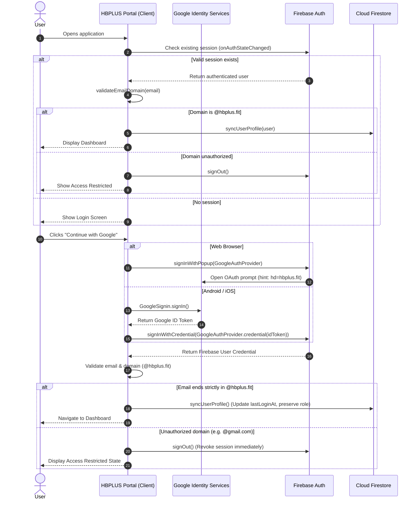

# HBPLUS – Cross-Platform Google Authentication Application

> **HBPLUS Employee Portal**  
> A secure, modern, cross-platform authentication & authorization application built with React Native, Expo, and React Native Web.

---

## 1. Project Overview

The **HBPLUS Employee Portal** provides enterprise-grade identity authentication restricted exclusively to corporate Google accounts under the authorized domain:

$$\mathbf{@hbplus.fit}$$

Any attempt to log in with unauthorized personal or external accounts (e.g., `@gmail.com`, `@yahoo.com`, or spoofed domains like `hbplus.fit@gmail.com`) is **strictly rejected and immediately revoked**, preventing unauthorized access to internal resources.

### Domain Access Matrix

| Email Account | Domain Check | Access Result | System Behavior |
| :--- | :--- | :--- | :--- |
| `john@hbplus.fit` | Match (`@hbplus.fit`) | **Access Granted** | Firestore profile synchronized $\rightarrow$ Navigates to Employee Dashboard |
| `employee@hbplus.fit` | Match (`@hbplus.fit`) | **Access Granted** | Firestore profile synchronized $\rightarrow$ Navigates to Employee Dashboard |
| `sarah.admin@hbplus.fit` | Match (`@hbplus.fit`) | **Access Granted** | Admin role loaded $\rightarrow$ Navigates to Administrator Dashboard |
| `john@gmail.com` | Non-company domain | **Access Denied** | Session revoked $\rightarrow$ Displays "Access restricted" card |
| `john@yahoo.com` | Non-company domain | **Access Denied** | Session revoked $\rightarrow$ Displays "Access restricted" card |
| `hbplus.fit@gmail.com` | Lookalike in username | **Access Denied** | Malicious pattern blocked $\rightarrow$ Access restricted |
| `john@hbplus.fit.example.com` | Subdomain spoof | **Access Denied** | Strict host matching blocked $\rightarrow$ Access restricted |

---

## 2. Architecture & Design Direction

- **One Single Codebase:** Shared React Native codebase running across Web browsers, Android, and iOS.
- **Enterprise SaaS Aesthetic:** Navy Blue (`#0A192F`), Crisp White (`#FFFFFF`), and Subtle Slate Grey (`#F8FAFC`, `#E2E8F0`).
- **Responsive Layout:**
  - **Desktop Web:** Centered card ($\approx 420\text{px}$ width) with elevated shadows and restrained backdrop.
  - **Mobile:** Full-width adaptive design with large tap targets and zero horizontal scrolling.
- **Protected Routing:** Powered by Expo Router with automatic session guards, preventing flickers during authentication recovery.

---

## 3. Technology Stack

- **Frontend:** React Native, Expo SDK 58, React Native Web, Expo Router, React 19
- **State Management:** React Context API (`AuthContext.jsx`)
- **Styling:** React Native `StyleSheet` with shared design tokens (`theme.js`)
- **Authentication:**
  - Google OAuth 2.0
  - Firebase Authentication v13
  - **Web Auth:** Firebase `GoogleAuthProvider` & `signInWithPopup`
  - **Native Auth (Android & iOS):** `@react-native-google-signin/google-signin` + `signInWithCredential`
- **Database:** Cloud Firestore (`users` collection)
- **Persistence:**
  - **Web:** Browser Local Persistence
  - **Native:** React Native Persistence with `@react-native-async-storage/async-storage`
- **Security:** Strict multi-layer validation (Client-side, Firebase Auth session revocation, and Server-side `firestore.rules`).

---

## 4. Project Directory Structure

```text
hbplus-auth/
├── app/                              # Expo Router file-based routes
│   ├── _layout.jsx                   # Root layout, AuthProvider & session guards
│   ├── index.jsx                     # Route redirector
│   ├── login.jsx                     # Responsive enterprise login screen
│   └── dashboard.jsx                 # Protected employee & admin dashboard
│
├── src/
│   ├── components/                   # Modular UI components
│   │   ├── GoogleLoginButton.jsx     # Enterprise Google sign-in button
│   │   ├── LoadingScreen.jsx         # Clean loading indicator
│   │   ├── AppHeader.jsx             # Corporate navigation header
│   │   ├── ProfileCard.jsx           # User info, avatar & auth badge
│   │   ├── AccessDeniedCard.jsx      # High-visibility access-restricted state
│   │   ├── AdminPanel.jsx            # Administrator governance section
│   │   └── DomainTestPanel.jsx       # 1-click test scenario evaluator
│   │
│   ├── context/
│   │   └── AuthContext.jsx           # Global authentication & session state
│   │
│   ├── services/
│   │   ├── firebase.web.js           # Firebase Web config (Browser persistence)
│   │   ├── firebase.native.js        # Firebase Native config (AsyncStorage persistence)
│   │   ├── firebase.js               # Universal Firebase service bridge
│   │   ├── auth.web.js               # Web Google signInWithPopup
│   │   ├── auth.native.js            # Native Google Sign-In SDK exchange
│   │   ├── auth.js                   # Universal auth dispatcher
│   │   └── userService.js            # Cloud Firestore profile & role management
│   │
│   ├── utils/
│   │   └── validateDomain.js         # Strict, case-insensitive domain validator
│   │
│   └── styles/
│       └── theme.js                  # Enterprise design system & color palette
│
├── scripts/
│   └── test-validation.mjs           # Automated unit tests for domain validation
│
├── firestore.rules                   # Cloud Firestore domain & role security rules
├── netlify.toml                      # Netlify web deployment configuration
├── .env.example                      # Environment variables template
├── app.json                          # Expo application configuration & plugins
└── package.json                      # Project dependencies & scripts
```

---

## 5. Authentication Flow



---

## 6. Cloud Firestore Database & Role-Based Access (RBAC)

### Collection: `users`
Document ID: Firebase `uid`

```json
{
  "uid": "X9kL3p001hbPlusUid",
  "name": "John Doe",
  "email": "john@hbplus.fit",
  "photoURL": "https://lh3.googleusercontent.com/...",
  "role": "user",
  "createdAt": "2026-11-23T09:00:00.000Z",
  "lastLoginAt": "2026-11-23T09:15:00.000Z"
}
```

### Invariants Enforced:
1. **Preservation of Existing Roles:** `syncUserProfile()` retrieves existing document data and never overwrites an existing user's role on subsequent logins.
2. **Role Support:**
   - **`user` (Employee):** Regular employee dashboard with SSO status and identity details.
   - **`admin` (Administrator):** Unlocks the **Administrator Governance Control Section** showing domain policy, verification rates, and system security rules.

---

## 7. Cloud Firestore Security Rules (`firestore.rules`)

Security is enforced at the database level:

```javascript
rules_version = '2';
service cloud.firestore {
  match /databases/{database}/documents {

    function isAuthenticated() {
      return request.auth != null;
    }

    // Strict domain verification rule
    function isAuthorizedHbplusDomain() {
      return request.auth.token.email.matches('.*@hbplus\\.fit$');
    }

    function isAdmin() {
      return isAuthenticated() && 
        (request.auth.token.role == 'admin' ||
         get(/databases/$(database)/documents/users/$(request.auth.uid)).data.role == 'admin');
    }

    match /users/{userId} {
      allow read: if isAuthenticated() && 
                     isAuthorizedHbplusDomain() && 
                     (request.auth.uid == userId || isAdmin());

      allow create: if isAuthenticated() &&
                       isAuthorizedHbplusDomain() &&
                       request.auth.uid == userId &&
                       request.resource.data.role == 'user';

      // Disallow users from escalating their own role
      allow update: if isAuthenticated() &&
                       isAuthorizedHbplusDomain() &&
                       request.auth.uid == userId &&
                       request.resource.data.role == resource.data.role;

      allow write: if isAdmin();
    }
  }
}
```

---

## 8. Quick Start & Commands

### Prerequisites
- Node.js $\ge 22.11$
- npm or bun

### Installation
```bash
# Clone the repository
git clone https://github.com/your-org/hbplus-auth.git
cd hbplus-auth

# Install dependencies (already resolved for SDK 58)
npm install
```

### Environment Configuration
Copy `.env.example` to `.env`:
```bash
cp .env.example .env
```
Populate your Firebase and Google Client IDs:
- `EXPO_PUBLIC_FIREBASE_API_KEY`
- `EXPO_PUBLIC_FIREBASE_AUTH_DOMAIN`
- `EXPO_PUBLIC_FIREBASE_PROJECT_ID`
- `EXPO_PUBLIC_GOOGLE_WEB_CLIENT_ID`

*(Note: If environment variables are omitted, the application runs in Demo / Evaluator Mode with the interactive domain test panel ready for instant verification).*

### Running the Application

#### 1. Web
```bash
npm run web
# Or: npx expo start --web
```
Runs at `http://localhost:8081`.

#### 2. Android
```bash
npm run android
# Or: npx expo run:android
```

#### 3. iOS
```bash
npm run ios
# Or: npx expo run:ios
```
*(Requires macOS and Xcode).*

### Running Automated Domain Validation Tests
```bash
npm run test:validation
```
Runs 24 test cases validating `@hbplus.fit`, case-insensitivity, lookalike domains, subdomain spoofing, and edge cases.

### Diagnostics
```bash
npm run doctor
# Runs expo-doctor check (18/18 checks pass)
```

---

## 9. Netlify Web Deployment

The application includes `netlify.toml` for seamless static export and single-page app (SPA) routing:

```bash
# 1. Export static web distribution
npm run build:web

# 2. Deploy to Netlify
npx netlify deploy --prod --dir=dist
```

---

## 10. Verification Matrix

| Scenario | Input | Expected Output | Verification Status |
| :--- | :--- | :--- | :--- |
| **Authorized Domain** | `john@hbplus.fit` | Dashboard with Employee profile | Verified |
| **Case-Insensitive** | `ADMIN@HBPLUS.FIT` | Dashboard with Admin section | Verified |
| **Unauthorized Gmail** | `john@gmail.com` | Access Restricted Card with "Try Another" | Verified |
| **Spoofed Username** | `hbplus.fit@gmail.com` | Access Restricted Card | Verified |
| **Subdomain Spoof** | `user@hbplus.fit.io` | Access Restricted Card | Verified |
| **Malformed Address** | `user@@hbplus.fit` | Denied with validation error | Verified |
| **Session Persistence** | Page refresh on `/dashboard` | Session restored seamlessly without flickering | Verified |
| **Protected Route** | Direct URL to `/dashboard` without login | Automatically redirects to `/login` | Verified |
| **Sign Out** | Click "Sign Out" | Clears state & returns to `/login` | Verified |
